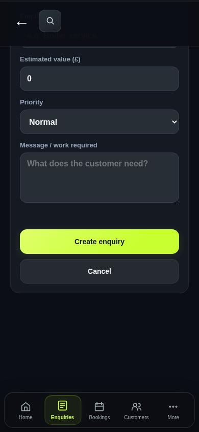
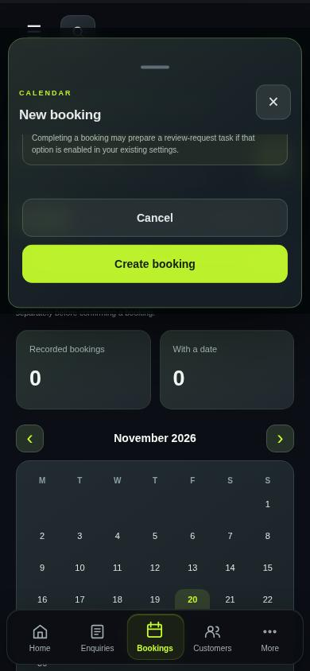
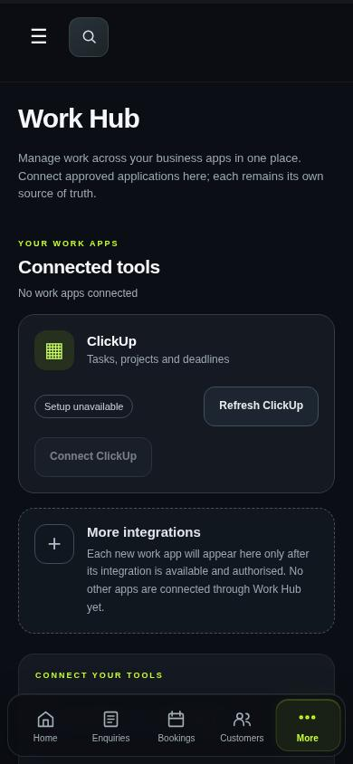
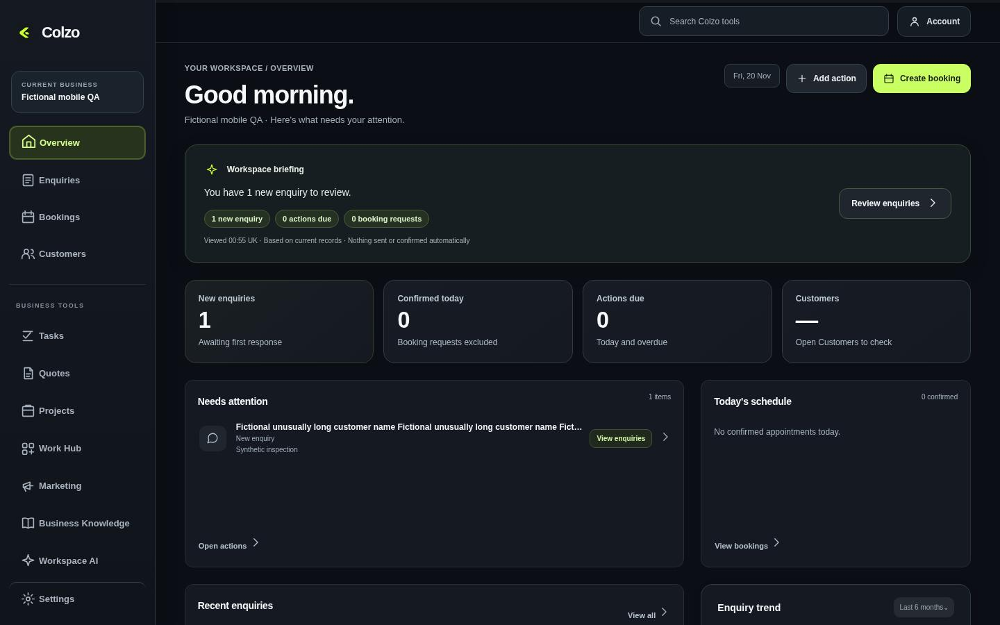

# Mobile browser evidence — 20 November 2026

Actual Colzo DOM/CSS in Chromium, with local fictional API fixtures. These images are NOT genuine iPhone Safari acceptance.

The booking image uses a simulated visual viewport of 360px height and 35px top offset while retaining the layout viewport. It demonstrates that form actions can scroll above the simulated keyboard region; no physical OS keyboard is shown.

The browser suite passes phone widths 375/390/430 and desktop 1366/1440. The saved-settings regression separately passes success, failure and edits during a pending save. Full Node source verification: 1,984 tests passed, zero failures/skips, 470 JS files verified.

## Final physical iPhone Safari acceptance

1. Open the new protected mobile candidate Preview, complete Vercel access, owner password and genuine MFA. Use fictional records only.
2. At normal text size and portrait orientation, scroll Home to the last shortcut. Confirm five-tab navigation and safe-area clearance. Repeat landscape and browser text zoom.
3. Open New enquiry. Focus each field, show/hide the keyboard, scroll to Create and Cancel, and verify both buttons remain inside the screen.
4. Open New booking. Confirm the keyboard stays closed initially. Focus Title/Start/End/Notes, show/hide the keyboard and switch fields. Confirm dates stack and the form scrolls independently with Close/Cancel/Create reachable. Close and reopen without saving, then create one labelled fictional booking, reload, and cancel it.
5. Check Customers, Quotes, Settings and Work Hub for overflow, bottom-nav obstruction, focus and back navigation. Save a fictional profile edit only if desired and confirm no stale unsaved warning after success.
6. Confirm Work Hub is neutral, ClickUp is one permission-gated catalogue entry, and LeadConnector is described only as future work. Log out, confirm private content clears, then reload. Record phone model, iOS/Safari version, orientation, zoom, keyboard states and any remaining screenshot evidence without credentials.

No Production, SQL, billing or provider activation is part of this procedure.

## Image integrity

enquiry-390.jpg SHA-256 252bb122dab074d9fc1b97620ed70677b60e7ef0226446a8e18ad274deb63861
booking-simulated-keyboard-390.jpg SHA-256 dc504de647445fcd45bc4bc18df39988494c123fd77619615ec366fa23a8051a
workhub-390.jpg SHA-256 b5348af8b3ba4468a1edf665bf84a17382730ec4bb25c90f6dd1bf2a46e3a16e
home-1440.jpg SHA-256 26023787df70325df5b98edd8b4c7b45df40f8f8aa632f38ab9f58d855bbbfa0
